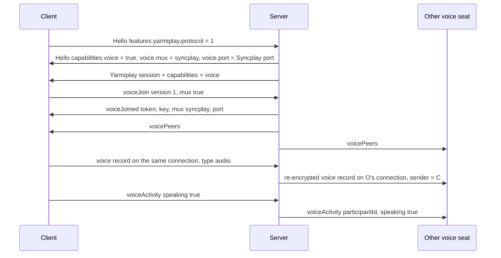

# Yarmiplay voice protocol (version 1)

Voice chat beside a Yarmiplay Syncplay server. YarmiplayServerTV 2.1.0 relays it on the Syncplay connection. YarmiplayTV implements against this document.

Voice is not part of Syncplay. A stock Syncplay client never sees it. A Yarmiplay client that does not get `capabilities.voice: true` skips voice.

Extension protocol stays **1** (`features.yarmiplay.protocol`). Voice is a capability inside that session. `voice.version` is **1**. The yv1 packet in section 6.1 is unchanged from server 2.0. What changed in 2.1.0 is where those packets travel: on the Syncplay connection, not on a separate port.

Native clients do **not** use WebRTC. Media is Opus frames. Browsers use the same frames as binary WebSocket messages on the Syncplay socket they already have.

## 1. What the server does

The server is a selective forwarder, not a mixer and not a peer mesh.

- Each voice participant sends Opus to the server. The server forwards that audio to the other voice participants in the same Syncplay room. Participants never send media to each other.
- Encryption is hop-by-hop AES-256-GCM. Each seat has its own key. The server decrypts a packet with the sender's key and re-encrypts it with each other seat's key. It holds plaintext in memory only long enough to do that. It does not decode Opus, mix, record, write audio to disk, or write audio or keys to the log.
- Forwarding is per Syncplay room, even when Syncplay room isolation is off. A participant hears only the other voice seats in the room they are in right now.
- Per-person volume, local mute of someone else, the local mic mute, push-to-talk, and device choice are client-only. The server has no mute or volume messages. Rooms have no host.
- Speaking indicators are client reports. The server does not inspect audio to decide who is talking.
- Join and leave sounds are played by the clients. The server ships no audio files and sends no sound event.

The machine running the server can hear the room, because forwarding requires it. That is not end-to-end encryption.

## 2. When voice exists

Voice is offered only when all of these are true:

- The client completed a Yarmiplay extension login (`features.yarmiplay` in Hello, vanilla mode off).
- The server's **Voice chat** setting is on (the default). The setting is `syncplay.voice` in the settings file, the **Voice chat** switch in the control panel, `--voice` / `--no-voice`, or `YARMIPLAYSERVERTV_VOICE`.
- The Syncplay listener is bound. Voice uses that listener. It does not bind a port of its own.

The client also has its own **Voice chat** setting. When that is off, the client does not send `voiceJoin`. The server cannot see that setting.

Either side off means no voice UI and no voice frames.

`GET /yarmiplay/info` does **not** advertise voice. That probe is allowed before login. The `voice` key is absent there, and `capabilities.voice` is removed from that probe.

When voice is not offered, every extension session (the Hello reply and later `Yarmiplay` messages) still carries:

```json
"voice": { "enabled": false, "message": "voice disabled on this server" }
```

`capabilities.voice` is false. The client shows `message` as-is. That string is exactly `voice disabled on this server`.

## 3. Capability handshake

`capabilities.voice` is a boolean, next to `fileRelay`, `jellyfin`, `plex`, `https`, `roomSettings`, `websocket`, and `mal`.

When `capabilities.voice` is true, the same `features.yarmiplay` object (and the same `Yarmiplay` state messages) also carries `voice`:

```json
"voice": {
  "version": 1,
  "enabled": true,
  "codec": "opus",
  "clockRate": 48000,
  "channels": 1,
  "ptime": 20,
  "maxBitrate": 32000,
  "fec": true,
  "dtx": true,
  "transport": "yv1",
  "mux": "syncplay",
  "port": 8999,
  "wsPath": "/yarmiplay/voice",
  "maxParticipants": 8
}
```

| Field | Meaning |
|---|---|
| `version` | This document. The client sends it in `voiceJoin`. |
| `enabled` | `true` when the table above is a live relay. `false` only in the short object in section 2. |
| `codec`, `clockRate`, `channels`, `ptime` | The only send format. One Opus frame is 20 ms, 48 kHz, mono. |
| `maxBitrate` | Encoder target, bits per second. The host sets it on the Voice page (`syncplay.voiceMaxBitrate`). A change is advertised immediately. |
| `fec`, `dtx` | The client turns Opus in-band FEC and DTX on when these are true. The host sets them on the Voice page. The server does not check the frames. |
| `transport` | `yv1`, the packet in section 6.1. Not WebRTC. |
| `mux` | `syncplay`. Frames travel on the Syncplay connection (section 6.0). There is no second port. |
| `port` | The Syncplay port the client is already connected to. Default 8999. Not a voice port. |
| `wsPath` | Legacy browser socket, still on `port` (section 6.4). New clients use section 6.0.2 instead. |
| `maxParticipants` | Voice seats in one room (`syncplay.voiceMaxParticipants`, 1–32, default 8). Syncplay itself can have more people. Lowering the cap does not remove people already in voice; the next join is refused. |

`udpPort`, `tcpPort`, and `fingerprint` are **not** sent. Server 2.0 used them for a separate UDP/TCP listener on port 9000 and a separate certificate. Server 2.1.0 does not listen there. A client that still opens port 9000 will not reach voice. A client that only speaks JSON lines is unaffected, because the server never writes a voice frame to a connection that did not opt in (section 6.0).

These appear in:

1. The Hello reply, under `Hello.features.yarmiplay`, for a client that opted in.
2. The post-login `{"Yarmiplay":{...}}` session message, and every later capabilities broadcast (the same message that already carries `capabilities`, `jellyfin`, `plex`, and `tls`).

Turning the server toggle off, or switching on vanilla mode, sends `voiceClosed` to anyone already in voice and then broadcasts the new capabilities (section 5.6).

A failure to bind the Syncplay port is logged with `EADDRINUSE` when that is the error. Voice cannot start, because it uses that port. The server does not open any other port for voice.

## 4. Signaling

Signaling is `{"Yarmiplay":{...}}` lines on the Syncplay connection the client already has (TCP, or TLS when the server has a certificate, or the text side of `GET /yarmiplay/ws`). One JSON object per line, same limits as the rest of the extension (`MAX_LINE_LENGTH` is 64 KiB). Lines end in `\n`. The server writes `\r\n`.

There is no second signaling socket. A voice message on a connection without an extension session is ignored. Vanilla sessions are never sent these lines.

Media uses that **same connection** when the client sets `mux` (section 6.0). The server does not send a separate host. `port` is the port the client already used.

## 5. Messages

Unknown `Yarmiplay` keys are ignored, including any `voiceSignal` from an older draft. Unknown `voiceClosed.reason` values are treated as `error`.

### 5.1 `voiceJoin` (client to server)

```json
{"Yarmiplay":{"voiceJoin":{"version":1,"mux":true}}}
```

| Field | Meaning |
|---|---|
| `version` | Must be `1`. |
| `mux` | `true`: this connection carries media. The server will write voice frames on it (section 6.0) as soon as the join is accepted. Omit it, or send `false`, to stay JSON-only on this connection. Older clients omit it. They can still use the legacy WebSocket in section 6.4. The server does not write voice frames to them. |

The room is the Syncplay room this connection is in. The client does not send a room name.

The server answers with `voiceJoined`, or with `voiceClosed` (`full`, `version`, `disabled`, or `vanilla`).

### 5.2 `voiceJoined` (server to client)

```json
{"Yarmiplay":{"voiceJoined":{
  "version": 1,
  "participantId": "c17",
  "username": "Alice",
  "room": "movie night",
  "token": "0123456789abcdef",
  "key": "base64 of 32 bytes",
  "transport": "yv1",
  "mux": "syncplay",
  "port": 8999,
  "wsPath": "/yarmiplay/voice",
  "codec": "opus",
  "clockRate": 48000,
  "channels": 1,
  "ptime": 20
}}}
```

`participantId` is `c` plus the decimal Syncplay connection id. It is stable until that Syncplay connection ends.

`token` is 16 lower-case hex characters (a big-endian u64). It identifies this seat on the media channel. `key` is standard base64 (no newlines) of the 32-byte AES-256-GCM key for this seat. Both are secrets of this connection. The server never sends one seat's key to another seat. A later `voiceJoin` on the same connection replaces both; the previous token stops working.

`port` is the Syncplay port. Do not open a new socket to it.

### 5.3 `voicePeers` (server to client)

Sent to every voice seat in the room when the set of seats or a speaking flag in the snapshot changes, including to the seat that just joined.

```json
{"Yarmiplay":{"voicePeers":{
  "room": "movie night",
  "self": "c17",
  "peers": [
    {"participantId":"c17","username":"Alice","speaking":false},
    {"participantId":"c18","username":"Bob","speaking":true}
  ]
}}}
```

`self` is the recipient. `peers` includes the recipient. There is no mid and no SSRD. The client maps `participantId` to a person.

Join and leave sounds play when `peers` gains or loses someone other than `self`.

### 5.4 `voiceActivity` (client to server, then server to the room)

Client, about itself only:

```json
{"Yarmiplay":{"voiceActivity":{"speaking":true}}}
```

Server, to the other voice seats in the room (not echoed to the sender):

```json
{"Yarmiplay":{"voiceActivity":{"participantId":"c17","username":"Alice","speaking":false}}}
```

The client sends `true` when its voice-activity detector or push-to-talk is open, and `false` when it closes. The server accepts at most **5** of these per seat per second and drops the rest without an error. It does not check them against the audio. An unchanged value is not forwarded.

### 5.5 `voiceLeave` (client to server)

```json
{"Yarmiplay":{"voiceLeave":{}}}
```

The client is leaving voice and staying in the Syncplay room. The server drops the seat, replies `voiceClosed` reason `left`, and sends a new `voicePeers` to the room.

### 5.6 `voiceClosed` (server to client)

```json
{"Yarmiplay":{"voiceClosed":{"reason":"disabled","message":"voice disabled on this server"}}}
```

| `reason` | When |
|---|---|
| `left` | This client sent `voiceLeave`. |
| `disabled` | The server toggle is off, or voice was not offered. `message` is `voice disabled on this server`. |
| `vanilla` | Vanilla Syncplay mode went on. The extension session ends as it does today; this line is sent first. |
| `full` | The room already has `maxParticipants` seats. |
| `room` | The Syncplay connection moved to another room. The old seat is gone. The client sends a new `voiceJoin` if it still wants voice. |
| `replaced` | A second `voiceJoin` on the same connection retired the previous token and key. The next message is `voiceJoined` with the new ones. |
| `version` | `voiceJoin.version` is not 1. |
| `error` | The server gave up. `message` is a short English sentence. |

After `voiceClosed` the client drops its media path, except for `replaced`, where it waits for the new `voiceJoined` and uses the new token. It does not retry `error` or `full` on its own more than once every 10 seconds. `room` is retried immediately with `voiceJoin` if the client still wants voice. `disabled` and `vanilla` are not retried until a capabilities broadcast says voice is back.

## 6. Media channel (`yv1`)

### 6.0 Multiplexing on the Syncplay connection

Voice media uses the **same connection** as Syncplay. There is no voice port. Do not open UDP 9000 or TCP 9000. Forward the Syncplay TCP port only.

A client opts in by sending `voiceJoin` with `"mux": true`. From that moment the server writes voice frames on that connection, interleaved with JSON lines. It does not wait for a separate socket.

A client that omits `mux` is left on JSON only. The server does not write a voice frame to that connection, so an older client that only parses JSON lines keeps working. Sending a voice frame on the connection also opts that seat in: the connection becomes the media path.

The most recently used path wins. A mux frame replaces a legacy WebSocket path, and a legacy WebSocket packet replaces mux, until the next one.

Two framings carry the same yv1 packet (section 6.1).

#### 6.0.1 TCP and STARTTLS byte stream

After the Syncplay connection is established (and after STARTTLS, if the client asked for it), the byte stream is a sequence of records. Peek the next byte.

**JSON record.** If the next byte is `{` (`0x7B`) or ASCII whitespace (`0x09` tab, `0x0A` LF, `0x0D` CR, `0x20` space), read bytes through the next `0x0A`. The line without the trailing newline, trimmed, is one JSON object. A whitespace-only line is skipped. A line longer than 65536 bytes closes the connection. This is the existing Syncplay and Yarmiplay JSON protocol, including `\r\n` lines.

**Voice record.** If the next byte is `0x1E` (ASCII Record Separator):

| Offset | Size | Field |
|---:|---:|---|
| 0 | 1 | Marker `0x1E` |
| 1 | 2 | Length `N`, big-endian unsigned 16-bit. `N` is the size of the yv1 packet only. It does not include the marker or the length field. |
| 3 | `N` | One yv1 packet from section 6.1. `N` is from 56 through 1200 inclusive. |

Any other first byte closes the connection. A length outside 56..=1200 closes the connection. Both are logged.

The marker and the length are not part of the yv1 packet and are not GCM additional data. Additional data is the 40-byte yv1 header only, as in section 6.1.

The server flushes each voice record. It writes a voice record only to a seat that opted in.

Worked example, offsets in the record. A 56-byte packet (header plus a 16-byte tag, no extra ciphertext) is the bytes:

```
1E 00 38   then 56 bytes starting with 59 56 01 ...
```

`0x0038` is 56. A packet that contains `0x0A` in the ciphertext is still one record, because the reader uses `N`, not the next newline.

#### 6.0.2 WebSocket `GET /yarmiplay/ws`

This is the browser's existing Syncplay socket, on the Syncplay port. When `mux` is true it is also the voice connection.

- A **text** message is one JSON object. A trailing newline is optional. The server sends text messages with no `0x1E` and no length prefix.
- A **binary** message is one yv1 packet from section 6.1. There is no `0x1E` and no length prefix. The WebSocket frame is the framing. The packet is 56 to 1200 bytes.
- The server sends voice to a mux seat as binary messages on this same socket.
- Ping and pong are WebSocket control frames, not voice.
- An `Origin` header is checked the same way as any `/yarmiplay/ws` upgrade. Pages that are not on the server's allowed list get 403. Native clients send no `Origin`.

A browser that ignores binary messages and never sends `mux: true` is unchanged.

### 6.1 Packet

One voice record carries one packet. Offsets below are from the start of the packet, after the record marker and length have been removed. Integers are big-endian.

| Offset | Size | Field |
|---:|---:|---|
| 0 | 2 | Magic `YV` (`0x59 0x56`) |
| 2 | 1 | Version `1` |
| 3 | 1 | Type: `1` audio, `2` keepalive, `3` bye |
| 4 | 8 | Token, the u64 from `voiceJoined` |
| 12 | 8 | Sender. The client sends `0`. The server writes the sender's connection id when it forwards. |
| 20 | 4 | Sequence, starting at any u32 and increasing by 1 per packet this seat sends (audio, keepalive, and bye) |
| 24 | 4 | Timestamp in samples at 48 kHz. The client sets it. The server copies it when forwarding. |
| 28 | 12 | AES-GCM nonce. Fresh for every packet, including every forwarded copy. |
| 40 | rest | Ciphertext and the 16-byte GCM tag |

The GCM additional data is the 40-byte header. The plaintext is:

| Type | Plaintext |
|---|---|
| `1` audio | One raw Opus packet. Not an RTP packet. No payload-type byte. Empty plaintext is rejected. |
| `2` keepalive | A single byte `0x00` |
| `3` bye | Empty, or up to 32 bytes the server ignores |

The whole packet is at most **1200** bytes and at least **56** (header + tag). The server drops anything else, a bad magic or version, a type it does not know, a non-zero sender on input, a token it does not know, a token that does not belong to the Syncplay connection the frame arrived on, a failed tag, a replayed sequence, or an audio plaintext it cannot treat as one frame under the size cap. Each drop is logged without the packet, the token, the key, or the audio.

Sequence replay uses a window of the last 64 sequence numbers per seat. Older or duplicate numbers are dropped.

Keepalives are not forwarded. On the mux path they are optional: the connection is already known, so a keepalive is not required before audio will flow. A client may still send one. Bye is not forwarded and does not by itself remove the seat; `voiceLeave` does that.

The conceptual RTP payload type, if a client thinks in RTP, is **111**. It is not on the wire.

### 6.2 What the server forwards

For an accepted audio packet the server builds one new packet per other seat in that room:

- That seat's token and key
- Sender set to the speaker's connection id
- The same sequence and timestamp
- A new nonce
- The same Opus plaintext

It does not send the packet back to the speaker. Seats in other rooms get nothing. A mux seat can receive audio as soon as its `voiceJoin` with `mux: true` has been accepted, before it has sent a frame. A seat that did not opt in and has not attached the legacy WebSocket gets nothing.

### 6.3 No separate socket

There is no voice UDP port, no voice TCP port, and no voice certificate. Opus is already sealed with AES-256-GCM inside the packet. The outer hop is the Syncplay TCP connection, STARTTLS with the Syncplay certificate when the client asked for TLS, or the WebSocket on that same port.

UPnP, when the Syncplay UPnP switch is on, forwards the Syncplay TCP port only. It does not map a voice port. A client behind NAT does not need its own port forward. It already has the Syncplay connection.

### 6.4 Legacy browser socket

Older clients may still open a second WebSocket on the **same Syncplay port**:

`GET /yarmiplay/voice?t=<token>`

- `token` is the 16-hex `token` from `voiceJoined`, not the Syncplay session token.
- The upgrade is rejected without a known token, in vanilla mode, or when voice is off. The body when voice is off is `voice disabled on this server`.
- An `Origin` header is checked the same way as `/yarmiplay/ws`.
- Each binary WebSocket message is one packet from section 6.1, with no `0x1E` and no length prefix. Text messages are ignored.
- Signaling stays on the Syncplay connection. This socket is media only.

New clients should use section 6.0 instead of opening this socket. It exists so a client from server 2.0 that already speaks this WebSocket can still send audio without a separate port. Clients that only knew UDP/TCP 9000 need the framing in section 6.0.

### 6.5 Room binding and lifetime

A voice seat is tied to one Syncplay connection and one room.

- Syncplay disconnect, timeout, or kick: the server drops the seat with no `voiceClosed` (the signaling connection is already gone) and sends `voicePeers` to the others. Further packets with the old token are dropped.
- Room change: `voiceClosed` reason `room`, then the client may `voiceJoin` again. The old token is dead immediately, before the client joins the new room's voice.
- Server toggle off or vanilla mode: `voiceClosed`, then the capabilities broadcast. Nothing is written down.
- Two `voiceJoin`s on one connection: `voiceClosed` reason `replaced`, then `voiceJoined` with a new token and key. Peers get `voicePeers`.
- The room's voice set is empty when the last voice seat leaves. That does not change the Syncplay room.

### 6.6 What is deliberately absent

- No WebRTC, SDP, ICE, or `voiceSignal`.
- No separate voice port.
- No server-side mute of another user, and no message that would mute someone for the room.
- No per-person volume, mic gain, output gain, or device id on the wire.
- No recording control, no storage, no replay.
- No voice before extension login, and no voice for a client that did not put `features.yarmiplay` in Hello.
- No mixing. Each seat stays a separate stream so the client can apply local mute and volume.

## 7. Client behavior the server relies on

- Send 20 ms mono Opus at 48 kHz, about 32 kbit/s, with in-band FEC and DTX.
- Seal packets exactly as in section 6.1. Use a new nonce every time. Increment the sequence for every packet, including keepalives.
- Send `voiceJoin` with `"mux": true` and then write voice records on the Syncplay connection (section 6.0.1), or binary WebSocket messages on `/yarmiplay/ws` (section 6.0.2). Do not open a second port.
- Read the same way: a JSON line stays a JSON line, and a `0x1E` record or a binary WebSocket message is a voice packet. Do not parse a voice record as JSON.
- Send `voiceActivity` from the local voice-activity detector (open mic) or from push-to-talk, not from both at once. Push-to-talk sends `speaking: true` only while the key or button is held.
- Apply local mute and volume per `participantId`.
- Play join and leave sounds locally when `voicePeers` changes. The sounds are original assets shipped with the client.
- Hide the voice controls when `capabilities.voice` is not true, or when the client's own voice setting is off. When `voice.enabled` is false, show `voice.message` (`voice disabled on this server`).

## 8. Sequence



## 9. Versioning

`voice.version` 1 is this document, including the packet in section 6.1. Server 2.1.0 did not change the packet, the reasons, or the legacy WebSocket path, so the version stayed 1. It removed the separate UDP/TCP listener. Clients that read `voice.mux == "syncplay"` use section 6.0. Clients that do not opt in keep a JSON-only Syncplay connection.

A future change that breaks a packet, a reason, or section 6.0 adds version 2 and keeps answering version 1 until clients have moved. The extension protocol number stays 1 so existing Hello parsing does not change.
