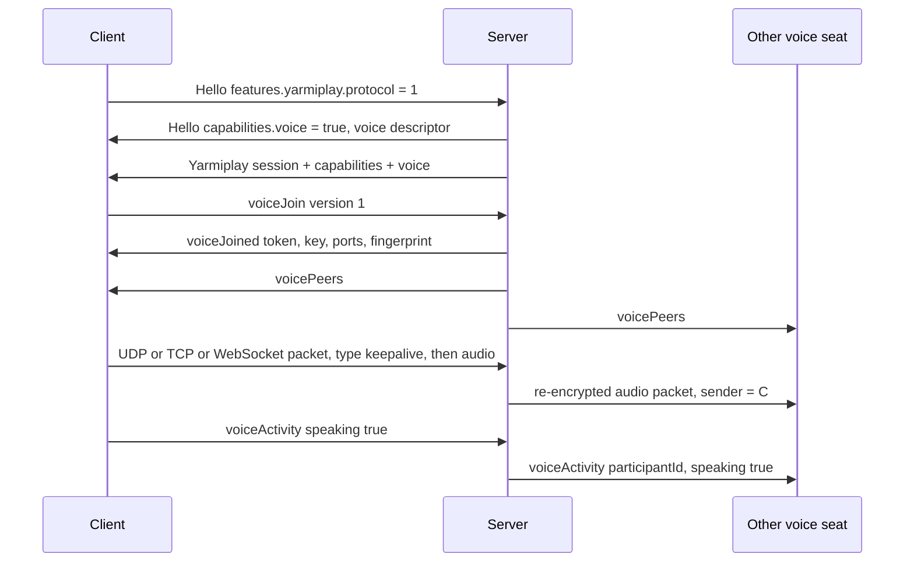

# Yarmiplay voice protocol (version 1)

Voice chat beside a Yarmiplay Syncplay server. YarmiplayTV 2.7.0 implements against this document. YarmiplayServerTV 2.0.0 is the first server.

Voice is not part of Syncplay. A stock Syncplay client or server never sees it. A Yarmiplay client that does not get `capabilities.voice: true` skips voice and shows nothing.

Extension protocol stays **1** (`features.yarmiplay.protocol`). Voice is a capability inside that session. `voice.version` is **1**, this document.

Native clients do **not** use WebRTC. Media is Opus frames on a small framed channel. Browsers use the same frames on a WebSocket, because a page cannot open a raw UDP socket.

## 1. What the server does

The server is a selective forwarder, not a mixer and not a peer mesh.

- Each voice participant sends Opus to the server. The server forwards that audio to the other voice participants in the same Syncplay room. Participants never send media to each other.
- Encryption is hop-by-hop AES-256-GCM. Each seat has its own key. The server decrypts a packet with the sender's key and re-encrypts it with each other seat's key. It holds plaintext in memory only long enough to do that. It does not decode Opus, mix, record, write audio to disk, or write audio or keys to the log.
- Forwarding is per Syncplay room, even when Syncplay room isolation is off. A participant hears only the other voice seats in the room they are in right now.
- Per-person volume, local mute of someone else, the local mic mute, push-to-talk, and device choice are client-only. The server has no mute or volume messages. Rooms have no host.
- Speaking indicators are client reports. The server does not inspect audio to decide who is talking.
- Join and leave sounds are played by the clients. The server ships no audio files and sends no sound event.

The machine running the server can hear the room, because forwarding requires it. That is not end-to-end encryption.

## 2. When voice exists

Voice is offered only when all of these are true:

- The client completed a Yarmiplay extension login (`features.yarmiplay` in Hello, vanilla mode off).
- The server's **Voice chat** setting is on (the default).
- The voice listeners are bound (UDP and TCP).

The client also has its own **Voice chat** setting. When that is off, the client does not send `voiceJoin` and does not open a media socket. The server cannot see that setting.

Either side off means no voice UI and no voice connection.

`GET /yarmiplay/info` does **not** advertise voice. That probe is allowed before login. Voice exists only on a logged-in extension session. The `voice` key is absent from `capabilities` there.

## 3. Capability handshake

`capabilities.voice` is a boolean, next to `fileRelay`, `jellyfin`, `plex`, `https`, `roomSettings`, `websocket`, and `mal`.

When `capabilities.voice` is true, the same `features.yarmiplay` object (and the same `Yarmiplay` state messages) also carries `voice`:

```json
"voice": {
  "version": 1,
  "codec": "opus",
  "clockRate": 48000,
  "channels": 1,
  "ptime": 20,
  "maxBitrate": 32000,
  "fec": true,
  "dtx": true,
  "transport": "yv1",
  "udpPort": 9000,
  "tcpPort": 9000,
  "wsPath": "/yarmiplay/voice",
  "maxParticipants": 8,
  "fingerprint": "hex sha-256 of the voice certificate"
}
```

| Field | Meaning |
|---|---|
| `version` | This document. The client sends it in `voiceJoin`. |
| `codec`, `clockRate`, `channels`, `ptime` | The only send format. One Opus frame is 20 ms, 48 kHz, mono. |
| `maxBitrate` | Encoder target, bits per second. |
| `fec`, `dtx` | The client turns Opus in-band FEC and DTX on. The server does not check the frames. |
| `transport` | `yv1`, the channel in section 6. Not WebRTC. |
| `udpPort`, `tcpPort` | Ports the server is listening on. Both are 9000 unless a test server bound an ephemeral port. |
| `wsPath` | Browser media socket. Section 6.4. |
| `maxParticipants` | Voice seats in one room. Syncplay itself can have more people. |
| `fingerprint` | Lower-case hex SHA-256 of the voice listener's certificate (DER). Section 6.3. |

These appear in:

1. The Hello reply, under `Hello.features.yarmiplay`, for a client that opted in.
2. The post-login `{"Yarmiplay":{...}}` session message, and every later capabilities broadcast (the same message that already carries `capabilities`, `jellyfin`, `plex`, and `tls`).

When voice is off, `capabilities.voice` is false and the `voice` object is omitted. Turning the server toggle off, or switching on vanilla mode, sends `voiceClosed` to anyone already in voice and then broadcasts the new capabilities (section 5.7).

A voice listener that fails to bind leaves `capabilities.voice` false. A UPnP failure does not.

## 4. Signaling

Signaling is more `{"Yarmiplay":{...}}` lines on the Syncplay connection the client already has (TCP, or TLS when the server has a certificate, or the text WebSocket `GET /yarmiplay/ws`). One JSON object per line, same limits as the rest of the extension (`MAX_LINE_LENGTH` is 64 KiB).

There is no second signaling socket. A voice message on a connection without an extension session is ignored. Vanilla sessions are never sent these lines.

The client addresses UDP and TCP media at the **same IP or DNS name** it used for Syncplay, on `udpPort` / `tcpPort`. The server does not send a separate host field. The browser uses `wsPath` on that same host and port (section 6.4).

## 5. Messages

Unknown `Yarmiplay` keys are ignored, including any `voiceSignal` from an older draft. Unknown `voiceClosed.reason` values are treated as `error`.

### 5.1 `voiceJoin` (client to server)

```json
{"Yarmiplay":{"voiceJoin":{"version":1}}}
```

The room is the Syncplay room this connection is in. The client does not send a room name.

The server answers with `voiceJoined`, or with `voiceClosed` (`full`, `version`, `disabled`, or `vanilla`).

### 5.2 `voiceJoined` (server to client)

```json
{"Yarmiplay":{"voiceJoined":{
  "version": 1,
  "participantId": "c17",
  "username": "Alice",
  "room": "movie night",
  "token": "0123456789abcdef",
  "key": "base64 of 32 bytes",
  "udpPort": 9000,
  "tcpPort": 9000,
  "wsPath": "/yarmiplay/voice",
  "fingerprint": "hex sha-256",
  "codec": "opus",
  "clockRate": 48000,
  "channels": 1,
  "ptime": 20
}}}
```

`participantId` is `c` plus the decimal Syncplay connection id. It is stable until that Syncplay connection ends.

`token` is 16 lower-case hex characters (a big-endian u64). It identifies this seat on the media channel. `key` is standard base64 (no newlines) of the 32-byte AES-256-GCM key for this seat. Both are secrets of this connection. The server never sends one seat's key to another seat. A later `voiceJoin` on the same connection replaces both; the previous token stops working.

### 5.3 `voicePeers` (server to client)

Sent to every voice seat in the room when the set of seats or a speaking flag in the snapshot changes, including to the seat that just joined.

```json
{"Yarmiplay":{"voicePeers":{
  "room": "movie night",
  "self": "c17",
  "peers": [
    {"participantId":"c17","username":"Alice","speaking":false},
    {"participantId":"c18","username":"Bob","speaking":true}
  ]
}}}
```

`self` is the recipient. `peers` includes the recipient. There is no mid and no SSRD. The client maps `participantId` to a person.

Join and leave sounds play when `peers` gains or loses someone other than `self`.

### 5.4 `voiceActivity` (client to server, then server to the room)

Client, about itself only:

```json
{"Yarmiplay":{"voiceActivity":{"speaking":true}}}
```

Server, to the other voice seats in the room (not echoed to the sender):

```json
{"Yarmiplay":{"voiceActivity":{"participantId":"c17","username":"Alice","speaking":false}}}
```

The client sends `true` when its voice-activity detector or push-to-talk is open, and `false` when it closes. The server accepts at most **5** of these per seat per second and drops the rest without an error. It does not check them against the audio. An unchanged value is not forwarded.

### 5.5 `voiceLeave` (client to server)

```json
{"Yarmiplay":{"voiceLeave":{}}}
```

The client is leaving voice and staying in the Syncplay room. The server drops the seat, replies `voiceClosed` reason `left`, and sends a new `voicePeers` to the room.

### 5.6 `voiceClosed` (server to client)

```json
{"Yarmiplay":{"voiceClosed":{"reason":"disabled","message":"Voice chat is off on this server"}}}
```

| `reason` | When |
|---|---|
| `left` | This client sent `voiceLeave`. |
| `disabled` | The server toggle went off, or voice was not offered. |
| `vanilla` | Vanilla Syncplay mode went on. The extension session ends as it does today; this line is sent first. |
| `full` | The room already has `maxParticipants` seats. |
| `room` | The Syncplay connection moved to another room. The old seat is gone. The client sends a new `voiceJoin` if it still wants voice. |
| `replaced` | A second `voiceJoin` on the same connection retired the previous token and key. The next message is `voiceJoined` with the new ones. |
| `version` | `voiceJoin.version` is not 1. |
| `error` | The server gave up. `message` is a short English sentence. |

After `voiceClosed` the client drops its media socket, except for `replaced`, where it waits for the new `voiceJoined` and opens a new socket with the new token. It does not retry `error` or `full` on its own more than once every 10 seconds. `room` is retried immediately with `voiceJoin` if the client still wants voice. `disabled` and `vanilla` are not retried until a capabilities broadcast says voice is back.

## 6. Media channel (`yv1`)

### 6.1 Packet

One UDP datagram is one packet. TCP and the browser WebSocket carry the same packet bytes (TCP adds a length prefix; the WebSocket frame is the packet).

Offsets are from the start of the packet. Integers are big-endian.

| Offset | Size | Field |
|---:|---:|---|
| 0 | 2 | Magic `YV` (`0x59 0x56`) |
| 2 | 1 | Version `1` |
| 3 | 1 | Type: `1` audio, `2` keepalive, `3` bye |
| 4 | 8 | Token, the u64 from `voiceJoined` |
| 12 | 8 | Sender. The client sends `0`. The server writes the sender's connection id when it forwards. |
| 20 | 4 | Sequence, starting at any u32 and increasing by 1 per packet this seat sends (audio, keepalive, and bye) |
| 24 | 4 | Timestamp in samples at 48 kHz. The client sets it. The server copies it when forwarding. |
| 28 | 12 | AES-GCM nonce. Fresh for every packet, including every forwarded copy. |
| 40 | rest | Ciphertext and the 16-byte GCM tag |

The GCM additional data is the 40-byte header. The plaintext is:

| Type | Plaintext |
|---|---|
| `1` audio | One raw Opus packet. Not an RTP packet. No payload-type byte. Empty plaintext is rejected. |
| `2` keepalive | A single byte `0x00` |
| `3` bye | Empty, or up to 32 bytes the server ignores |

The whole packet is at most **1200** bytes and at least **56** (header + tag). The server drops anything else, a bad magic or version, a type it does not know, a non-zero sender on input, a token it does not know, a failed tag, a replayed sequence, or an audio plaintext it cannot treat as one frame under the size cap.

Sequence replay uses a window of the last 64 sequence numbers per seat. Older or duplicate numbers are dropped.

Keepalives are not forwarded. They refresh the server's idea of the sender's UDP address. The client sends one every 5 seconds while the media socket is up, and one immediately after the socket opens, including on TCP and the WebSocket (so the server knows the path is alive). Bye is not forwarded and does not by itself remove the seat; `voiceLeave` does that.

The conceptual RTP payload type, if a client thinks in RTP, is **111**. It is not on the wire.

### 6.2 What the server forwards

For an accepted audio packet the server builds one new packet per other seat in that room:

- That seat's token and key
- Sender set to the speaker's connection id
- The same sequence and timestamp
- A new nonce
- The same Opus plaintext

It does not send the packet back to the speaker. Seats in other rooms get nothing. A seat with no media path yet (no UDP packet seen, and no TCP or WebSocket attached) gets nothing until it has one. A seat uses one path. The path that most recently attached or sent replaces the previous one.

### 6.3 UDP, TCP, and the certificate

Default listen port is **9000** for UDP and **9000** for TCP, on all interfaces. It is not the Syncplay port. Syncplay stays on its own port (default 8999) so a media burst cannot stall the JSON session.

- **UDP** carries the packet in section 6.1 and nothing else. This is the path native clients use when UDP works.
- **TCP** is the fallback, in 2.0.0, for a network that blocks UDP. The client opens TLS, then writes frames: a big-endian u16 length (the packet size, not including the length) and then the packet. Lengths outside 56..=1200 close the connection.
- The TLS certificate is generated when the voice listeners start. It is self-signed and separate from the Syncplay certificate. `fingerprint` is the SHA-256 of that certificate's DER encoding. The client checks the certificate it saw against `fingerprint` and aborts if they differ. It does not need a public CA for this hop.
- The TCP listener expects the client to send the ClientHello. The client uses the Syncplay host as the TLS name only if it matches a name on the certificate; otherwise it connects by address and relies on the fingerprint. The certificate's name is `voice.local`. Pin the fingerprint, not the name.

There is no STUN, TURN, ICE, DTLS-SRTP, or SDP. Friends reach voice the same way they reach Syncplay: the host's port is forwarded, by hand or by UPnP.

UPnP, when the Syncplay UPnP switch is already on and voice is on, also maps UDP 9000 and TCP 9000. UPnP failure does not clear `capabilities.voice`.

A client behind NAT does not need its own port forward. It sends to the server's forwarded port.

### 6.4 Browsers

A browser cannot send the UDP packet and should not be given a raw TCP socket. Media uses a second WebSocket on the Syncplay port:

`GET /yarmiplay/voice?t=<token>`

- `token` is the 16-hex `token` from `voiceJoined`, not the Syncplay session token.
- The upgrade is rejected without a known token, in vanilla mode, or when voice is off.
- An `Origin` header is checked the same way as `/yarmiplay/ws`. Pages that are not on the server's allowed list get 403. Native clients send no `Origin`.
- Each binary WebSocket message is one packet from section 6.1, with no length prefix. Text messages are ignored. The server sends binary messages the same way.
- Signaling (`voiceJoin`, `voicePeers`, and the rest) stays on the text Syncplay connection, including `/yarmiplay/ws`. That socket does not carry media. Its binary frames stay ignored.

This is the only browser media path. It is the same hop-by-hop AES-256-GCM, so the page can seal and open packets with WebCrypto (`AES-GCM`, 256-bit key, 12-byte nonce, the 40-byte header as additional data).

### 6.5 Room binding and lifetime

A voice seat is tied to one Syncplay connection and one room.

- Syncplay disconnect, timeout, or kick: the server drops the seat with no `voiceClosed` (the signaling connection is already gone) and sends `voicePeers` to the others. Further packets with the old token are dropped.
- Room change: `voiceClosed` reason `room`, then the client may `voiceJoin` again. The old token is dead immediately, before the client joins the new room's voice.
- Server toggle off or vanilla mode: `voiceClosed`, then the capabilities broadcast. Nothing is written down.
- Two `voiceJoin`s on one connection: `voiceClosed` reason `replaced`, then `voiceJoined` with a new token and key. Peers get `voicePeers`.
- The room's voice set is empty when the last voice seat leaves. That does not change the Syncplay room.

### 6.6 What is deliberately absent

- No WebRTC, SDP, ICE, or `voiceSignal`.
- No server-side mute of another user, and no message that would mute someone for the room.
- No per-person volume, mic gain, output gain, or device id on the wire.
- No recording control, no storage, no replay.
- No voice before extension login, and no voice for a client that did not put `features.yarmiplay` in Hello.
- No mixing. Each seat stays a separate stream so the client can apply local mute and volume.

## 7. Client behavior the server relies on

- Send 20 ms mono Opus at 48 kHz, about 32 kbit/s, with in-band FEC and DTX.
- Seal packets exactly as in section 6.1. Use a new nonce every time. Increment the sequence for every packet, including keepalives.
- Prefer UDP. If UDP does not pass a keepalive within a few seconds, open the TCP fallback. Browsers use section 6.4 only.
- Check `fingerprint` before trusting the TCP connection.
- Send `voiceActivity` from the local voice-activity detector (open mic) or from push-to-talk, not from both at once. Push-to-talk sends `speaking: true` only while the key or button is held.
- Apply local mute and volume per `participantId`.
- Play join and leave sounds locally when `voicePeers` changes. The sounds are original assets shipped with the client.
- Hide all voice UI when `capabilities.voice` is not true, or when the client's own voice setting is off.

## 8. Sequence



## 9. Versioning

`voice.version` 1 is this document. A future change that breaks a packet, a reason, or the browser path adds version 2 and keeps answering version 1 until clients have moved. The extension protocol number stays 1 so existing Hello parsing does not change.
